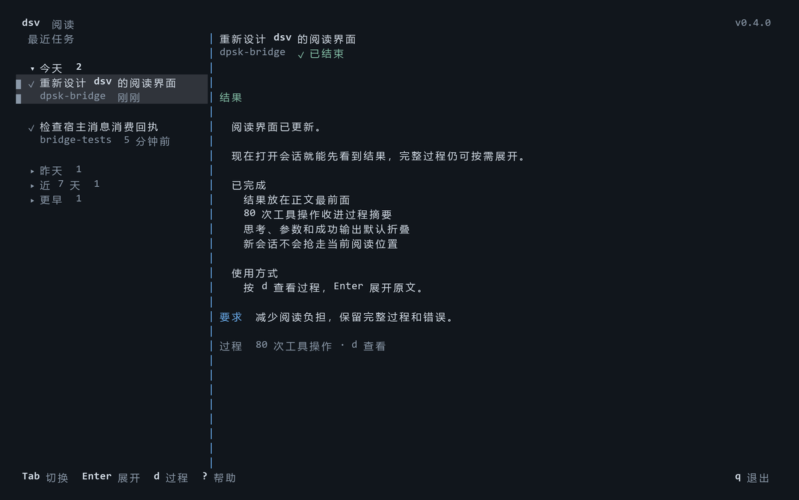

# dpsk-bridge · 通用 DeepSeek 桥

让具备本地命令执行能力的宿主 agent 委派任务给 DeepSeek Harness，并在执行期间交换问题、回复和更新。Claude Code、Codex 是安装预设；其他宿主可以直接使用 CLI，或安装 skills 到自己的目录。本项目包含任务桥 `dsb`、会话查看器 `dsv` 和两个 skills，本身不是 MCP server。

## 依赖与安装

要求 Node.js >=24.9、Git、npm 和 `@deepseek-ai/dsh` >=0.2.1-rc.2。安装及技能同步脚本面向 Windows PowerShell；核心 CLI 有 Windows/Linux 测试。当前仅支持 SDK 协议、v4 日志和新版作业格式。

克隆到长期保留的目录，阅读脚本后选择一个宿主安装。需要多个宿主时分别执行：

```powershell
git clone https://github.com/AAAA9731/dpsk-bridge.git
cd dpsk-bridge
.\scripts\install.ps1 -Target Codex
.\scripts\install.ps1 -Target Claude
.\scripts\install.ps1 -Target Generic -SkillsDir 'C:\tools\my-agent\skills'
```

脚本安装锁定依赖、安装或升级不满足要求的 dsh，同步所选宿主的 skills，通过 npm link 提供 dsb/dsv。安装目录之后不要移动；安装后重新打开宿主会话。它保留 dsh 鉴权与 `~/.dsh/patches/`，覆盖托管 skill 前备份到 `~/.dpsk-bridge/backups/`。

从旧项目名升级：先结束旧作业，将 origin 更新为上方地址，拉取代码并重新运行所选宿主安装命令。脚本迁移旧的 skill 归属清单和命令入口；不读取旧作业格式，历史日志不会删除。卸载所选宿主时加 `-Uninstall`；Generic 同时保留原 `-SkillsDir`。其他宿主仍在使用时保留共享命令。

## 双向任务

```text
dsb run --cwd "项目路径" --brief "brief.md" --timeout 2700
dsb run --cwd "项目路径" --brief "brief.md" --patch "MCP配置.yml"
dsb run --cwd "项目路径" --brief "brief.md" --provider deepseek-official --model deepseek-v4-flash
dsb status <作业ID>
dsb events <作业ID> --after 0 --limit 20
dsb send <作业ID> --message-file "追加要求.md"
dsb answer <作业ID> --request <requestId> --answer "回复.json"
dsb result <作业ID>
dsb cancel <作业ID>
```

run 保持连接；宿主保留执行句柄，在有界等待间读取问题和更新。events 返回完整事件与字节 cursor，将它传给下一次 --after；more 表示还有未读事件。status.pendingRequests 列出问题或审批。普通问题的回复文件按原问题 ID 一一填写：

```json
{"answers":[{"id":"original-question-id","selected":[],"custom":"宿主补充的信息"}]}
```

审批使用 `{"outcome":"allowed-once"}`、`{"outcome":"rejected"}` 或 `{"outcome":"cancelled"}`。宿主依据实际授权决定，桥不会自动授予权限；需要用户决定时先澄清。随作业加载的 Harness 插件转发提问和审批，SDK 负责追加消息及实时日志，每项作业拥有独立 SDK 进程。

send/answer 返回 queued 只表示进入邮箱，须在事件中确认 input_delivered 或 input_rejected。追加要求进入后续回合，不打断当前步骤。结束后不能原地追加，应新建任务或 retry。

默认路由为 deepseek-official/deepseek-v4-flash，可用参数或 DPSK_PROVIDER/DPSK_MODEL 覆盖。模型路由在每次 SDK 初始化时明确设置。--dsh-entry 可以指定本机 dsh 的 lib/bin.js。

作业、完整报告、前后 Git 状态、交互事件和用量保存在 `$DSH_HOME/bridge/jobs/<ID>/`，默认 `~/.dsh/bridge/jobs/<ID>/`。Git 状态清单不是备份。processState、模型的 reportedResult 和宿主验收相互独立。

```text
dsb retry <作业ID> --feedback "失败证据.md"
dsb review <作业ID> --verdict accepted --note "实际检查与测试证据"
dsb stats
```

返工保留原始要求及配置摘要，建立新会话；原 brief 或 MCP patch 变化时要求新建任务。失败或非 OK 报告不能标为 accepted。用量仅覆盖匹配的根会话，缺失数据不当作零，不冒充包含全部子代理的账单。

## 高并发

默认最多 8 项任务；共享同一个 DSH_HOME 的新版启动器共同排队。DPSK_CONCURRENCY 或 --max-concurrent 可设置 1–256。参与请求取最小上限；统一提高并发时，应给全部启动器设置同一个环境变量。实际吞吐受服务配额、机器资源和范围冲突限制，256 不是实测吞吐保证。

```text
dsb run --cwd "项目" --brief "前端.md" --scope src/frontend --max-concurrent 32
dsb run --cwd "项目" --brief "后端.md" --scope src/backend --max-concurrent 32
dsb run --cwd "项目" --brief "调查.md" --read-only
dsb run --cwd "另一个项目" --brief "场景编辑.md" --resource unity-editor-main
```

- 默认写任务锁住整个 Git 工作区；非 Git 目录使用当前目录。
- --scope 可重复，路径相对 Git 工作区根目录；不重叠的范围并行，父子目录或重叠写入等待。
- --read-only 任务相互并行，与重叠写任务互斥。
- 相同 --resource 跨工作区互斥，可协调共享编辑器或服务。

scope、只读与资源声明是协作约定，不是文件系统沙箱。原有宿主权限和 Harness 沙箱仍适用。取消与总超时包含排队。旧启动器不参加新调度协议，升级前应结束旧作业。

崩溃或无法确认清理成功时保留预约。核对原任务和全部相关进程停止、检查部分成果后，才能 `dsb unlock <ID> --confirmed-stopped`。不能凭日志无更新判定进程停止。

## dsv 与自动更新

```text
dsv                         全屏 TUI
dsv ls [N]                  最近会话
dsv show <ID|latest>         结果优先的阅读视图
dsv show <ID> --details     按时间查看过程
dsv show <ID> --full        完整原始过程
dsv watch [ID]              实时跟踪
dsv --version
dsv update --check          立即检查，不安装
dsv update                  检查并安装正式更新
dsv update --auto on        开启自动更新
dsv update --auto off       关闭自动更新（默认）
```

dsv 读取当前 v4 明文/zstd 日志，增量处理残缺尾部、原生工具结果、system/developer 消息、结构化错误和用量。最高 generation 优先，未来格式提示未验证。DSH_SESSIONS_ROOT 可指定日志目录。



默认阅读视图先显示待回复问题和最新结果，任务原文可展开，工具流水汇成一行；思考、成功输出、时间戳和用量不占正文。按 d 切换完整过程，工具调用与返回合成一条可展开记录，计划更新按轮次汇总。新会话不会自动切走当前任务。

左侧按最后更新时间分成今天、昨天、近 7 天、更早，按本地日历日划分。今天和启动时当前会话所在组默认展开，其余历史组收起；分组只展示非空组并附任务数。点击组标题，或在列表中选中组后按 Enter/空格折叠展开，左右键收起/展开。折叠不切换正文，刷新期间保留折叠状态。

Tab 在任务列表与正文间切换，方向键或 j/k 移动，Enter/空格展开，Esc 返回列表，PgUp/PgDn 翻页，g/G 到顶/底，e/E 全部展开/收起。r 显示思考，i 查看路径/ID/用量，? 查看帮助，q 退出。自动切换(a)和提示音(b)默认关闭，可按需开启。窄窗口直接显示正文。日志状态不证明进程存活或验收结果。缓存最多 60 个会话，单会话 16 MiB/3 万事件，总解码缓存 64 MiB，超过限制会提示。

TUI 异步检查 GitHub 最新正式 Release，缓存 6 小时，常驻时每小时重新评估。发现更新后顶栏提示，按 u 安装。网络检查失败不影响查看；普通命令行查看不联网检查。设置 NO_UPDATE_NOTIFIER=1、CI 环境或 --no-update-check 可关闭 TUI 自动检查，显式 dsv update 仍可用。

开启自动更新后，发现正式新版本会等桥接作业结束，再独占调度系统更新。排队等待最多 60 秒，繁忙时保留提示待下次重试。仅接受官方 origin、干净工作区和可快进历史；本地修改或分叉暂停更新，不强制覆盖。更新依次安装锁定依赖、运行检查、同步已注册宿主的 skills；完成后重新打开 dsv 和宿主会话。

仅 Git 克隆并 link 的目录支持自动更新。失败记录在 `~/.dpsk-bridge/update-state.json`；若代码已快进而安装失败，按记录修复，不自动重置。清理失败保留独占预约时，先关闭原 dsv、确认记录的所有进程已退出，再运行 `dsv update --recover --confirmed-stopped` 恢复该预约。检查使用 GitHub Releases API，版本比较采用 npm 的 [semver](https://github.com/npm/node-semver)。常见 [update-notifier](https://github.com/sindresorhus/update-notifier) 面向 npm registry，因此本项目直接跟随 GitHub Release。

## 发布与验证

维护者先提交版本号和 lockfile 并通过 CI，再推送与 package.json.version 一致的正式 tag。release.yml 会检查版本、运行测试、打包并创建 GitHub Release；只有提交或 tag、没有 Release 时不会提示用户更新。例如发布下一补丁：

```text
npm version patch
git push origin main --follow-tags
```

本地验证：

```text
npm ci --ignore-scripts
npm run check
npm test
```

回归覆盖 v4 日志、消息竞态、提问/审批生命周期、真实多进程争抢、独占更新、Git 快进与失败恢复、通用宿主安装。设置 DPSK_REAL_DSH_ENTRY 为当前 dsh 入口后，`node --test test/real-dsh.test.mjs` 对真实 Harness 运行隔离的本地模拟模型测试，不请求付费模型。

## 许可证

Copyright (C) 2026 AAAA9731。以 [LGPL-2.1](LICENSE) 发布。本项目与 Anthropic、OpenAI、DeepSeek 均无官方关联。
